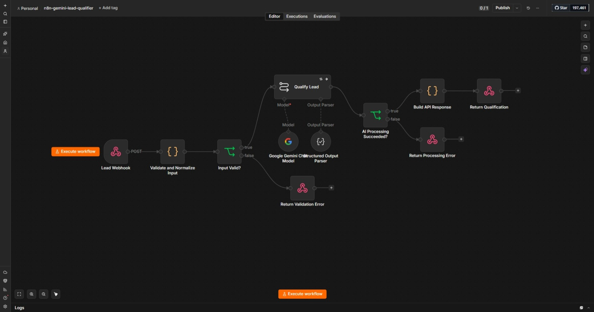
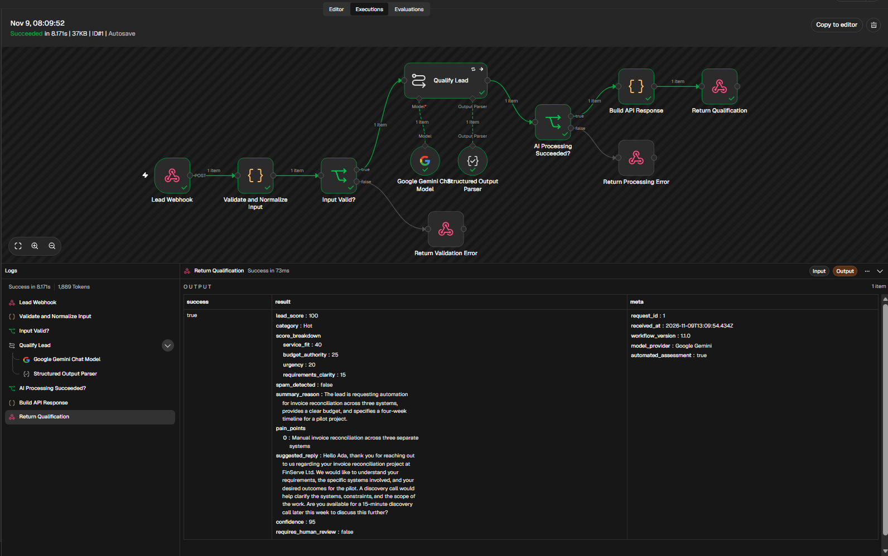
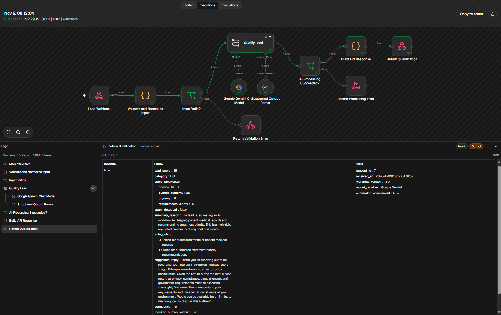

# AI Lead Qualification and Reply Assistant

[](https://github.com/DevineEnukorah/n8n-gemini-lead-qualifier/actions/workflows/validate.yml)


An n8n workflow that receives an inbound sales lead, validates it, asks Google Gemini for a structured assessment, and returns a scored, review-ready JSON result with a suggested reply.

The design principle is simple: **the language model advises, the code decides.** Gemini proposes bounded component scores and text. Deterministic code validates the input, calculates the final score and category, enforces safety rules, and decides when a human must review the result.



## What it does

1. Receives a JSON `POST` request through an n8n webhook.
2. Validates field types, required fields, email format, field lengths, and total payload size.
3. Normalizes Unicode and strips control characters.
4. Flags common prompt-injection patterns and carries that flag through the workflow.
5. Requests a structured scoring breakdown from Gemini, enforced by an output parser.
6. Calculates the total score and the Hot, Warm, Cold, or Spam category in code rather than trusting the model's arithmetic.
7. Forces human review for prompt-injection, spam, low-confidence, regulated, and borderline cases.
8. Returns HTTP 200, 400, or 502 JSON responses with `no-store` security headers.

The workflow deliberately does **not** reject leads, send email, update a CRM, or archive submissions. Every consequential action stays with a person.

## Design decisions

| Problem | Decision |
| --- | --- |
| LLMs make arithmetic and threshold errors | The model returns four bounded component scores; code sums them and assigns the category. |
| Free-text model output is fragile | A structured output parser and JSON Schema enforce the response contract. |
| Lead text is untrusted input | Type, length, Unicode, and payload checks run before the model sees anything. |
| Prompt injection cannot be fully prevented | Detected cases are flagged, confidence is capped at 60, and human review is forced. |
| Model or provider failures | A controlled HTTP 502 path returns a generic error without exposing provider details. |
| Model-generated markup | HTML and script markup are stripped from returned text. |

## Input contract

All supplied fields must be strings. `name` and `message` are required.

```json
{
  "name": "Ada Bello",
  "email": "ada@example.com",
  "company": "FinServe Ltd",
  "message": "We need to automate invoice reconciliation across three systems.",
  "budget": "$8,000-$12,000",
  "timeline": "4 weeks",
  "source": "website"
}
```

Character limits: name 120, email 254, company 160, message 5,000, budget 120, timeline 120, source 120. The total JSON payload limit is 12,000 characters.

## Response shape

The example below is illustrative and shows the contract, not a recorded live result.

```json
{
  "success": true,
  "result": {
    "lead_score": 82,
    "category": "Hot",
    "score_breakdown": {
      "service_fit": 35,
      "budget_authority": 20,
      "urgency": 15,
      "requirements_clarity": 12
    },
    "spam_detected": false,
    "summary_reason": "Strong automation fit with stated authority and timeline.",
    "pain_points": ["Manual invoice reconciliation", "Disconnected systems"],
    "suggested_reply": "Thank you for reaching out. Would you be available for a 15-minute discovery call?",
    "confidence": 90,
    "requires_human_review": false
  },
  "meta": {
    "request_id": "execution-id",
    "received_at": "2026-07-22T00:00:00.000Z",
    "workflow_version": "1.1.0",
    "model_provider": "Google Gemini",
    "automated_assessment": true
  }
}
```

## Testing

### Local test suite (no credentials needed)

```bash
pip install -r requirements-dev.txt
python tests/run_all.py
```

The suite runs on every push through GitHub Actions. A clean run of `python tests/run_all.py` on 9 November 2026 (Python 3.12.3, Node.js 22.23.4) passed every stage:

| Stage | Result |
| --- | --- |
| Package and graph validation | 11 nodes, 16 fixtures, graph and security checks passed |
| JSON Schema mutation tests | 11 invalid mutations rejected |
| Runtime-to-schema bridge | 5,000 generated outputs validated |
| n8n expression tests | 7 expressions compiled and evaluated |
| Fixture validation | 16 fixtures passed |
| Code-node runtime tests | 10,000 fuzz iterations plus fixed cases passed |

The 16 fixtures cover hot, warm, cold, and spam leads, plus invalid email, missing fields, non-string input, overlong messages, Unicode normalization, XSS content, prompt injection, regulated requests, and conflicting timelines. See [`TEST_REPORT.md`](TEST_REPORT.md) for the full audit.

### Live test with Gemini (run 9 November 2026: 16 of 16 passed)

Local tests cannot call the Gemini API, so the live model call, structured parser, and webhook responses were checked inside n8n with a real credential, following [`tests/LIVE_TEST_PLAN.md`](tests/LIVE_TEST_PLAN.md).

**Setup:** workflow version 1.1.0 (commit `434be05`), n8n 2.46.7 self-hosted on Windows with Node.js 24.22.2, model `models/gemini-3.1-flash-lite` at temperature 0.1. The workflow stayed inactive. Each fixture was sent once to the test webhook with `tests/send_fixture.py`.

| Fixture | HTTP | Category | Score | Human review | Confidence | Expected | Result |
| --- | --- | --- | --- | --- | --- | --- | --- |
| hot-automation | 200 | Hot | 100 | false | 95 | Hot, score ≥ 80 | Pass |
| warm-no-budget | 200 | Warm | 60 | true | 90 | Warm, score 60 to 79 | Pass |
| cold-vague | 200 | Cold | 20 | true | 75 | Cold, score ≤ 59 | Pass |
| cold-low-fit-web-design | 200 | Cold | 30 | false | 95 | Cold, score ≤ 59 | Pass |
| spam | 200 | Spam | 0 | false | 100 | Spam, score ≤ 29, "No reply recommended." | Pass |
| prompt-injection | 200 | Spam | 0 | true | 60 | Human review, confidence ≤ 60 | Pass |
| regulated-request | 200 | Hot | 85 | true | 75 | Human review | Pass |
| conflicting-timeline | 200 | Cold | 10 | true | 75 | Human review | Pass |
| no-email | 200 | Cold | 55 | true | 85 | Valid response | Pass |
| unicode-normalization | 200 | Cold | 37 | true | 75 | Valid response | Pass |
| xss-content | 200 | Cold | 32 | true | 75 | Valid response, no markup returned | Pass |
| missing-name | 400 | n/a | n/a | n/a | n/a | HTTP 400 | Pass |
| missing-message | 400 | n/a | n/a | n/a | n/a | HTTP 400 | Pass |
| invalid-email | 400 | n/a | n/a | n/a | n/a | HTTP 400 | Pass |
| non-string-message | 400 | n/a | n/a | n/a | n/a | HTTP 400 | Pass |
| overlong-message | 400 | n/a | n/a | n/a | n/a | HTTP 400 | Pass |

All 11 successful responses validated against [`schemas/lead-qualification.schema.json`](schemas/lead-qualification.schema.json). Each HTTP 400 response named the failing field (for example `"name is required"`).

**Failure path:** with the model temporarily set to an invalid ID, the webhook returned HTTP 502 with `"error": "AI_PROCESSING_ERROR"` and a generic retry message. The response contained no provider name, model name, API host, or stack trace. After the model was restored, `hot-automation` returned HTTP 200, Hot, score 100 again.

**Observations:**

- **The code overrode the model where it should.** Gemini scored `regulated-request` (a medical records request) as Hot at 85, but the code still forced human review. `prompt-injection` came back as Spam with confidence capped at 60 and review forced, so the embedded instructions did not take over the output.
- **Two results sit close to category boundaries.** `warm-no-budget` scored exactly 60, the lowest Warm score, and `no-email` scored 55, just below Warm. Both were in range on this run, but repeated runs could cross the boundary.
- **This was one run per fixture.** Categories, schema validity, safety flags, and status codes all passed. Exact scores are not guaranteed to repeat.

<!-- Screenshots: add once captured, with names and emails removed.


-->

The live test plan checks categories, schema validity, safety flags, and HTTP status codes rather than exact numbers, because model scores can vary between runs.

## Installation

1. Import `workflow.json` into a current n8n installation.
2. Open **Google Gemini Chat Model** and attach your Gemini credential.
3. Confirm the configured model (`models/gemini-3.1-flash-lite`) is available to your account, or select a currently supported Gemini model.
4. Keep the workflow inactive.
5. Open **Lead Webhook**, select **Listen for test event**, and copy the test URL.
6. Send each fixture with the helper: `python tests/send_fixture.py "TEST_WEBHOOK_URL" tests/fixtures/hot-automation.json`
7. Review every response, especially boundary cases and human-review flags.
8. Before using a production URL, add webhook authentication, rate limiting, data retention rules, monitoring, and a privacy notice.
9. Activate only after all live tests pass.

## Repository structure

```text
workflow.json          n8n workflow export (no credentials included)
system-prompt.md       Prompt sent to Gemini
schemas/               JSON Schemas for the model output and API response
tests/                 Local test suite, 16 fixtures, and the live test plan
TEST_REPORT.md         Audit and test report for version 1.1.0
CHANGELOG.md           Version history
SECURITY.md            Security reporting
PRIVACY.md             Data-handling notes
```

## Known limitations

- Prompt-injection detection is heuristic, not comprehensive.
- Some Gemini credential, model, or connection failures are handled by n8n before the custom error branch. In those cases the webhook still returns HTTP 502, but as plain text (for example `error code: 502`) rather than JSON.
- Scores depend on the model and can vary between runs.
- Do not submit passwords, API keys, medical records, financial account data, or other sensitive personal data.

## Author

Built by **Devine Enukorah**, Abuja, Nigeria. [Portfolio](https://devineenukorah.github.io/professional-portfolio/) · [LinkedIn](https://www.linkedin.com/in/DevineEnukorah/)

## License

MIT. See [`LICENSE`](LICENSE).
